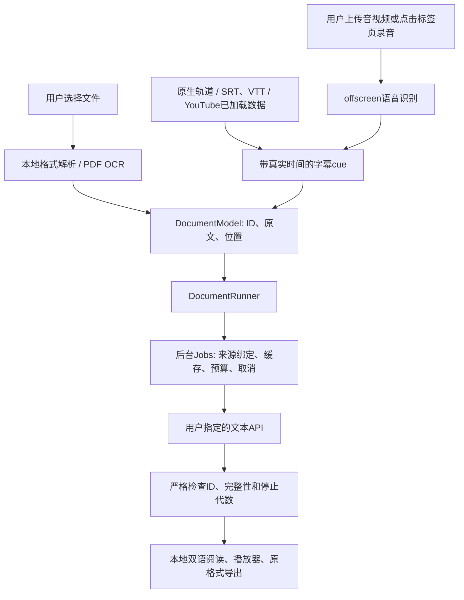

# 0.2.1 实现说明

这是独立编写的 MV3 客户端。沿用分析中观察到的“专用内容控制器→通用服务→按位置/ID回填”方式，不包含沉浸式翻译的源码、站点规则或后端。原版插件的静态推断与本项目的运行证据不能互相替代。

## 结构与调用链

文件入口是 `src/ui/workbench.js`。选择文件后调用 `openTextDocument`、`openXMLDocument` 或 `openPDF`，形成只含待译文字及位置的统一模型。`DocumentRunner.start → WB_START → Jobs.create → WB_PREPARE/WB_PREPARE_ITEMS → WB_BATCH → Jobs.run → buildRequest → requestJson → decodeResponse`，结果进入以段落ID为键的Map。没有完整结果时不能用空字符串或原文冒充译文导出。

网页仍使用 `Extractor → Scheduler → Jobs → Renderer.show`；译文由 `textContent` 插入带自有标记的节点，恢复只删除自己的节点。

## 各类文档如何处理

| 格式        | 提取与定位                                                                                     | 回填/导出                                                                                                     |
| ----------- | ---------------------------------------------------------------------------------------------- | ------------------------------------------------------------------------------------------------------------- |
| PDF         | PDF.js渲染/读取文本；无文字页渲染至Canvas，Tesseract本地英文/简中OCR；段落记录页码和提取方式。 | pdf-lib复制原页外观，删除交互Annots/AA，随原页附译文页；嵌入本地CJK字体，译文可再次提取。不是覆盖原版面文字。 |
| EPUB        | fflate检查并解包；container→OPF manifest→spine确定章节顺序；损坏的引用明确FILE_INVALID。       | 按章节段落插入译文，保留书内资源、mimetype首项及其不压缩要求；拒绝加密/DRM声明。                              |
| TXT/MD/HTML | 纯文本段落化；HTML在惰性模板中解析后移除脚本、事件与资源URL。                                  | 原文后追加译文；HTML导出只含清理后的本地内容。Markdown不进行复杂排版解释。                                    |
| DOCX        | 遍历正文/表格及页眉页脚、脚注尾注的WordprocessingML文字段落。                                  | 在原段落后添加译文run，保留其他XML/资源。                                                                     |
| PPTX        | 沿presentation关系定位真正幻灯片顺序，读取幻灯片和备注中的DrawingML段落。                      | 追加译文段落，保留幻灯片资源和关系。更多文字可能引起溢出，不能承诺版式完全不变。                              |
| XLSX        | 处理sharedStrings与inlineStr；跳过数字和公式单元格。                                           | 相同字符串中追加译文；公式、数字、样式保留。共享字符串工作表XML和样式已作字节比较。                           |

主实现：`src/documents/formats.js`、`pdf.js`、`runner.js`；本地第三方依赖来源/许可证在 `src/vendor/`。构建脚本锁定版本，不在用户阅读时下载远程脚本。

## 字幕与真实时间轴

`src/subtitles/cues.js`解析SRT/VTT，验证非负、有限、end>start以及唯一ID，保留原时间和VTT设置；`cueDocument`将cue转换为可批量翻译模型。`SubtitlePlayer`用浏览器TextTrack/VTTCue显示原文和译文，因此seek与全屏使用同一个播放器时钟。切换源或恢复时清除自己的cue并恢复原轨道模式。播放器手动offset单独应用，不修改导出时间。

原生轨道由 `src/content/video.js`提取；YouTube适配器优先读取当前播放器的字幕元数据，保留最多500条轨道，英文/中文不会被原先的40条截断。B站读取 `player.getManifest()` 的活动BVID/CID，复用播放器已经请求的当前CID字幕信息URL。两站不构造签名或绕过登录。手动导入与已完成译文走 `VIDEO_APPLY`，该路径没有翻译任务或API调用。

两站采用播放器容器内双语DOM层，隐藏TextTrack提供cuechange与真实时钟；视频元素自身全屏时改由native track显示。文字使用textContent，层不截获鼠标，14–28px随容器宽度调整。恢复时移除自己的层、属性、监听并恢复原轨道。当前时间附近cue先进入批量翻译，seek只在当前请求完成后重排待处理项，保留ID、时间与导出顺序。B站仅在字幕/录音活动期间每250ms读取公开CID，发现改变会停止旧字幕和录音；停止释放各自watch token。调用链与现场限制见 `platform-subtitles.md`。

## AI字幕与录音

语音接口单独配置端点、模型、Key、语言和带时间戳的响应格式。上传文件先存本机IndexedDB，offscreen用multipart发送文件、文件名、model、response_format与可选language；只在Authorization头放Key。识别结果必须有真实segment起止时间，再交给文本API翻译；纯文字返回报 `ASR_NO_TIMESTAMPS`，不会平均分配时间。上传单文件小于25 MiB，当前不自动拆分超大上传文件。

标签页链路：用户从视频页调用扩展→工作台选择视频并开始→后台 `tabCapture.getMediaStreamId`→offscreen `getUserMedia`→AudioContext恢复扬声器声音→每15秒创建独立MediaRecorder容器→解码核验和事务存储→ASR→`mergeTranscripts`→`DocumentRunner.extend`→`VIDEO_APPLY`。下一段先启动，上一段随后停止和保存，避免解码/磁盘等待期间漏录。起点来自每段启动前的真实视频时钟采样，不能按段号推算。

暂停、跳转、变速、换源会停止录音，丢弃正在录制的尾片，已录完整片段继续识别。显式取消/删除/关闭工作台才中止全部识别。`extend`保留同一个翻译job和预算；失败片段需用户点击重试，不自动再次计费。一次最多120段。录音是分段转录，会有片段时长加服务处理时间的延迟。

## 失败与不确定之处

配置、凭据、权限、解析、响应完整性和时间戳错误均直接报错；不自动换供应商、模型、代理或本地伪结果。可选缓存失效会明确标记，并继续真实翻译请求。后台丢失时显示中断，不能仅凭持久状态声称任务仍在运行。停止使用AbortController和代数检查拒绝迟到结果；远端可能已处理或计费。

已验证的具体样本/次数在 `verification.md`，真实DeepSeek测量在 `deepseek-live.md`。YouTube受机器人确认限制；B站正向CC读取受登录限制，真实播放器显示和同网址换P已验证。语音服务实际账户、跨域iframe、复杂/手写OCR、大文件自动分段、直播新增cue，以及任意Office版式保真仍未验证或未支持。正常关闭清除本次本地音频；系统断电不等同于正常关闭，不能保证断电后没有残留。
